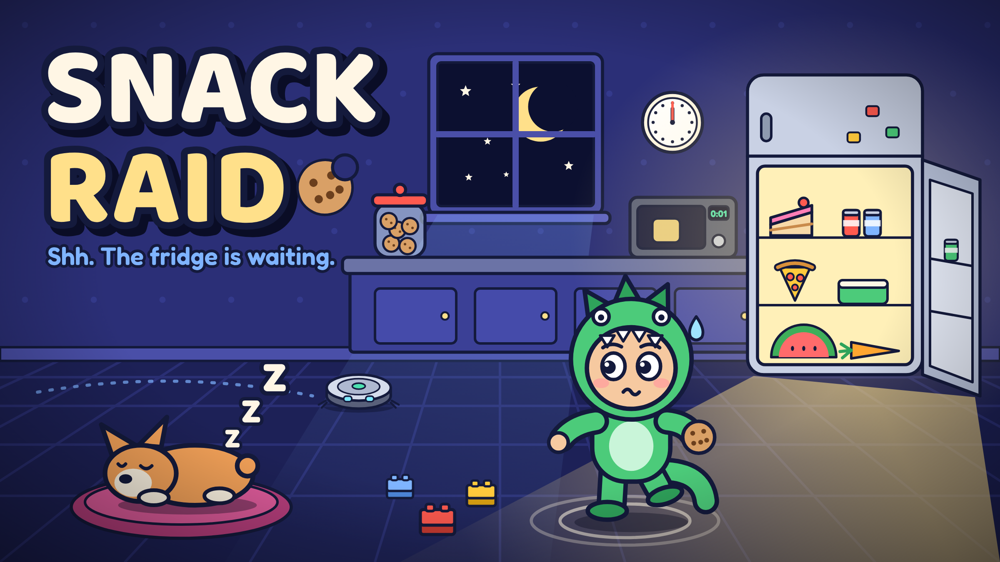

# Snack Raid

A funny stealth game for kids aged 10 to 12. It is midnight, you are hungry, and the snacks are downstairs. Sneak past your sleeping family, grab the goods, and get back under the blanket before anyone wakes up.



- **Plays in a browser.** Plain HTML, CSS and JavaScript. No build step, no dependencies, no server code.
- **Works offline** once hosted (it installs a service worker).
- **Made for landscape phones and tablets.** Also plays with a keyboard on a laptop.
- **Kid-safe.** No ads, no purchases, no accounts, no chat. Progress stays on the device. Up to 4 named raiders per device, and save codes to move one to another phone.

Version 0.2.0: all of World 1, and an Android app.

**Get the Android app:** https://priyesh25.github.io/snack-raid/apk/

## Play it on your computer

The game is a folder of static files in `app/`. Browsers will not load it straight from the file system, so serve it:

```sh
# Python 3
python3 -m http.server 8000 --directory app   # on Windows: python
# or Node
npx serve app
```

Then open http://localhost:8000.

**Keys:** WASD or arrows to walk. Hold Shift to tiptoe, Space to run. E is the big button, Q the small one, 1 2 3 use gadgets, M shows the map, Esc pauses.

## Host it

It is a static site. Any host works.

- **GitHub Pages:** push, then Settings > Pages > Deploy from a branch > `main` and `/ (root)`. The root `index.html` forwards to `app/`.
- **Netlify, Cloudflare Pages, Vercel:** no build command. Set the publish directory to `app`.

After each release, bump `VERSION` in `app/js/data.js` and `CACHE` in `app/sw.js` so phones pick up the new files.

## Put it on Android

- **The app:** on the phone, open https://priyesh25.github.io/snack-raid/apk/ and tap **Download the app**. The newest APK always sits at the repo root as `snack-raid-X.Y.Z.apk`. It is also on the [releases page](https://github.com/priyesh25/snack-raid/releases/latest).
- **Updates:** the app checks for a new version each time it opens, and about every 12 hours in the background. It shows a button and a notification. Installing over the top keeps progress.
- **No install:** open https://priyesh25.github.io/snack-raid/ in Chrome and choose "Add to Home screen".
- **New release:** bump `VERSION` in `app/js/data.js` and `CACHE` in `app/sw.js`, add `docs/release-notes/vX.Y.Z.md`, and push to `main`. GitHub builds and signs the APK, makes the release, and puts the APK at the root.
- How the app is built, signed and updated: [docs/android.md](docs/android.md).

## What is in this folder

| Path | What it holds |
| --- | --- |
| `app/` | The game. This is the web root you host |
| `snack-raid-X.Y.Z.apk` | The newest Android app. The Android workflow puts it here |
| `apk/` | The download page for the app. Also written by the workflow |
| `docs/game-design.md` | The full game design: rules, levels, economy, art direction |
| `docs/codes.md` | All 16 promo codes and 10 cheat codes |
| `docs/build-notes.md` | How the code is put together, and what is built versus planned |
| `docs/android.md` | The Android app: install, updates, signing, releases |
| `docs/release-notes/` | What is new in each version, shown on the GitHub release |
| `android/` | The Capacitor Android project |
| `.github/workflows/android.yml` | Builds the APK and publishes releases |
| `docs/context/` | The brief, the ideas that were considered, and the decisions with their reasons |
| `docs/screenshots/` | Screenshots from the build |
| `art/concept/` | Key art, cast sheet, snack and gadget icon sheets |
| `art/src/` | The Python scripts that draw all the art and export the game sprites |
| `tools/` | Tests, the code generator for promo and cheat codes, screenshot scripts, the APK page |
| `CLAUDE.md` | Project memory for working on this with Claude |

## What is built, and what is not yet

**In version 0.2.0**

- World 1, Home Sweet Home: 8 nights, a Sugar Dream bonus night and the boss night
- Noise rings, Zs, vision cones, light zones, cover sounds, hiding spots, doors, creaky boards, toy bricks
- The household: Dad, Mom, Mika, Baby Boo, Biscuit the dog, Dusty the robo-vac
- 12 snacks with their traits, and three Shh Moments (fridge, cookie jar, microwave)
- 8 gadgets with 5 levels each, Excuse Cards, stars, points, style bonuses, the Morning After
- Coins, Golden Wrappers, Sneak Ranks, the Toy Chest, 7 pajama sets, the Snack Streak
- 16 promo codes and 10 cheat codes
- Synthesized sound effects and a small music loop
- The Android app: full screen, offline, Back button, update notices
- Up to 4 named raiders per device, and save codes

**Designed but not built yet**

- Worlds 2 to 5, the other 11 gadgets, eat-now boosts, most Shh Moments
- Daily Craving, Daily Dares, Night Twists, the Sticker Album, bedroom decorating
- A hand-drawn bedroom hub and a real music track

`docs/build-notes.md` has the full list.

## Tests

```sh
node tools/sim-test.mjs      # game logic, including a bot that wins Night 1 and the boss
node tools/fuzz-test.mjs     # a random bot on every night, looking for crashes
node tools/codes-test.mjs    # every promo and cheat code
python3 tools/browser-test.py out/   # real browser run with screenshots (needs playwright)
python3 tools/raiders-test.py out/   # raiders, save codes, Back button, update button
```

## Credits

- Game design, code and art: made with Claude for Priyesh, November 2026.
- Fonts: Fredoka and Baloo 2, both under the SIL Open Font License. The license files sit next to the fonts in `app/assets/fonts/`.
