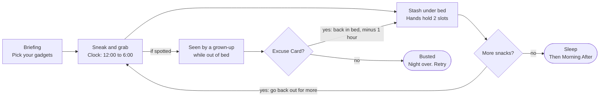
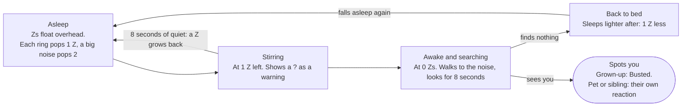
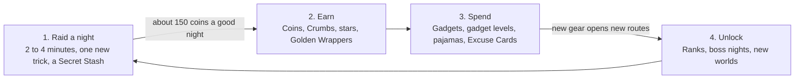
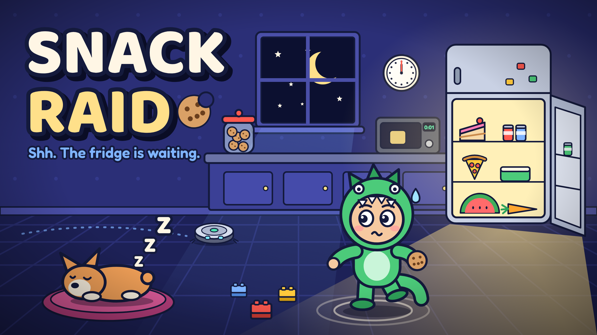
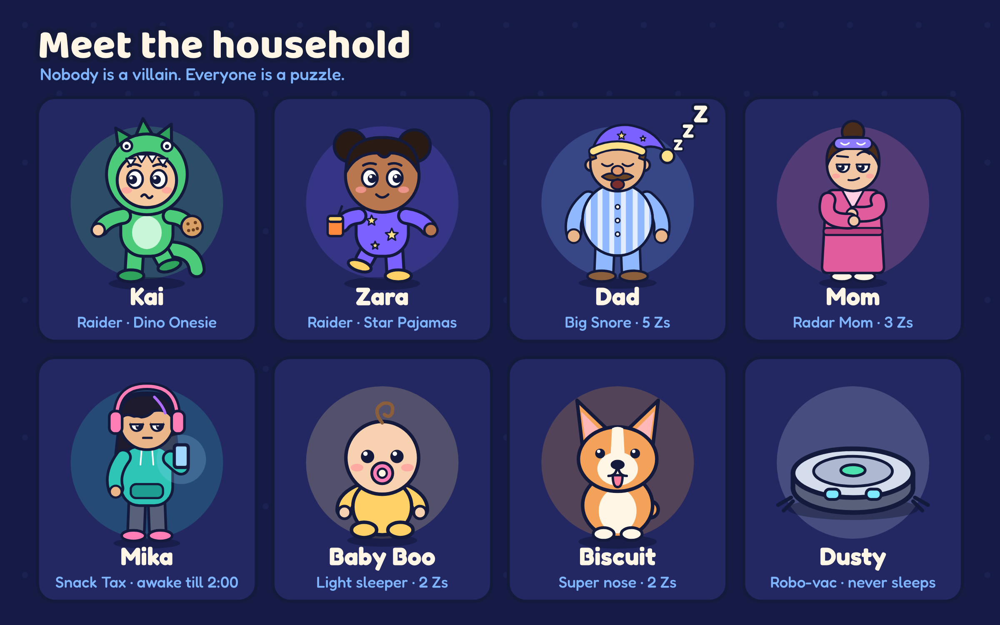
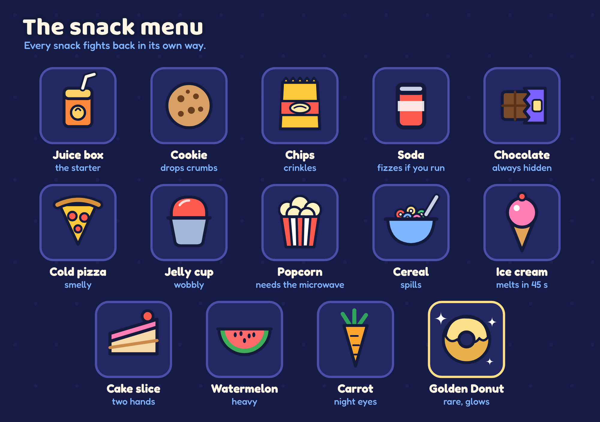
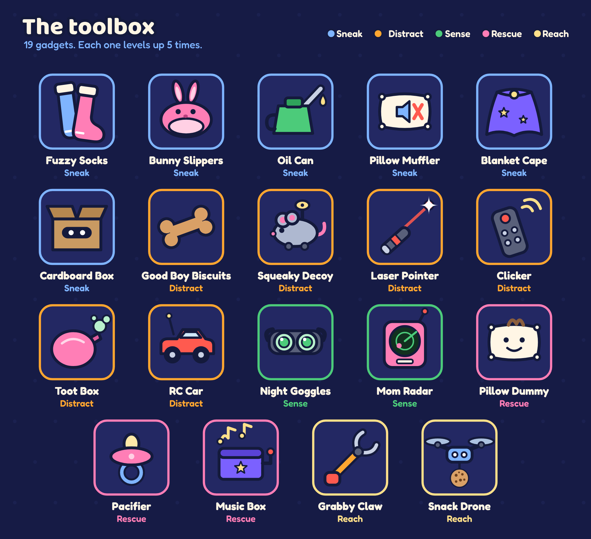
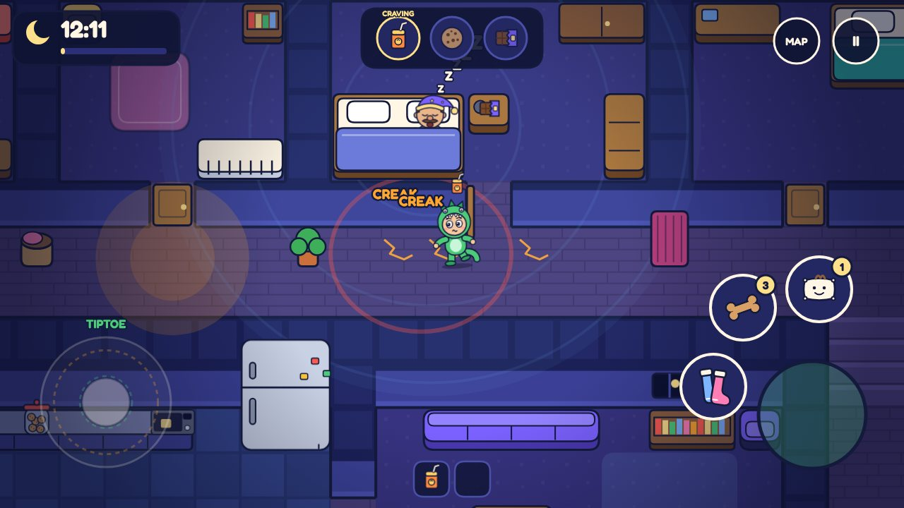
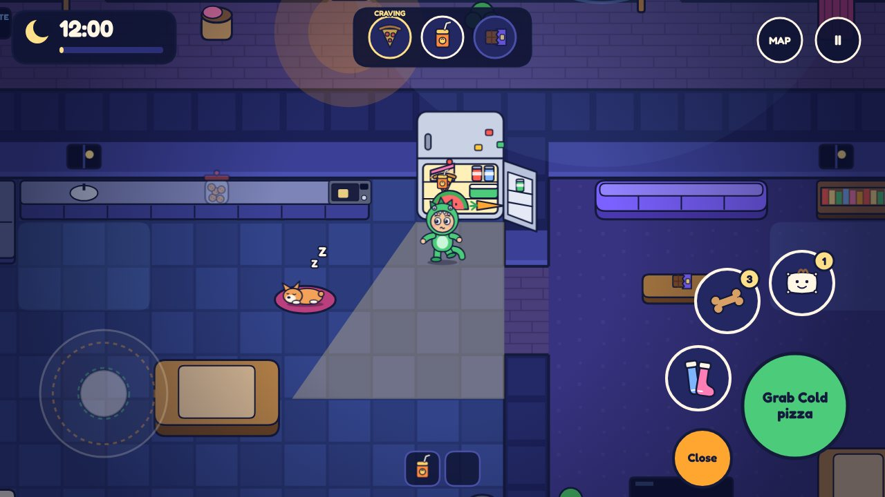
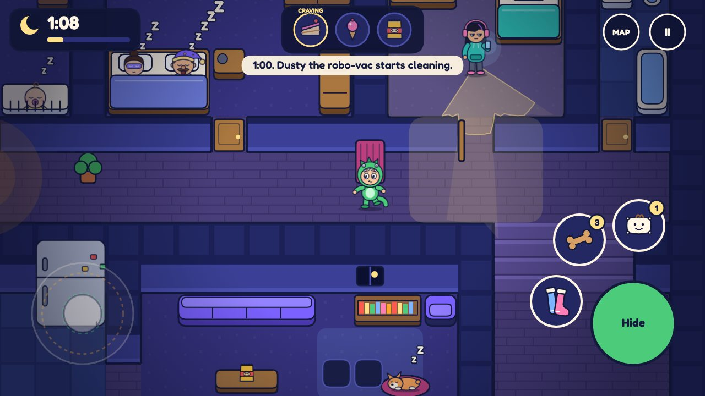

# Snack Raid: Game Design

Nov 11, 2026 · Priyesh

> This file is a copy of the living design doc at https://claude.ai/artifact/4ui3nEqzU1zTjZr1bngEGx. If the two ever disagree, fix both.

## The pitch

Snack Raid is a funny stealth game. It is midnight, you are hungry, and the snacks are downstairs. Sneak past your sleeping family, grab the goods, and get back under the blanket before anyone wakes up.

- **Player:** kids 10 to 12 who like Roblox, Mech Arena and Nintendo games
- **Platform:** Android phone or tablet, held sideways, works offline
- **Play style:** single player, top-down view, one night takes 2 to 4 minutes
- **Mood:** silly and tense, never scary. Getting caught is a joke, not a punishment

**Why this age group will love it**

- **They have lived it.** Every kid has crept to the kitchen at night. The game turns that into a mission.
- **Gadgets to collect and level up.** The same itch as upgrading mechs. Socks, decoys, a toy drone, each with 5 levels.
- **Dress up and decorate.** Dino onesies, shark suits, a bedroom to fill with trophies. The same itch as a Roblox avatar.
- **Small, clever levels with secrets.** Each night teaches one new trick, then twists it. The same feel as a Nintendo level.
- **Funny ways to fail.** Step on a toy brick. Burp at the wrong moment. Get taxed by your big sister. Kids will retell these.

**Three design rules**

- **Quiet is a skill.** How gently you push the stick decides how loud you are.
- **Greed is the fun.** One snack is safe. Three snacks is a story.
- **Every night has a surprise.** A new hazard, a secret stash, a golden donut, a twist.

## How a night plays

Every level is one night. You leave your bed, grab what is on the list, and get back before morning.

1. **Briefing.** Your bedroom shows tonight's Craving List: one Craving you must get and two Extras you can try for. You see who is home and pick your gadgets.
2. **Sneak out.** The clock starts at 12:00.
3. **Find the snacks.** Fridge, pantry, cookie jar, Mom's secret drawer. Each night hides them in new spots.
4. **Carry them home.** Your hands hold only 2 things. Drop snacks in the stash under your bed, then decide: stop here or go back for more.
5. **Sleep.** Hop into bed and tap Sleep to end the night.
6. **Morning After.** The family breakfast scene scores your raid and pays out coins, stars and stickers.

The top loop is the greed choice the whole game is built on. Getting seen only ends the night when you have no Excuse Card.

**The clock**

- The night runs from 12:00 to 6:00. One game hour is 40 seconds, so a full night is 4 minutes.
- Things happen on the clock. Dusty the robo-vac starts at 1:00. Mom gets water at 2:00. Players learn the rhythm of the house.
- At 6:00 the alarm rings and everyone wakes up. Be in bed by then.
- Boss nights run longer: one game hour is 60 seconds, so 6 minutes.

**You win when**

- The Craving is in your stash, and
- You are in bed before 6:00

**You lose when**

- A grown-up sees you out of bed (Busted), or
- The 6:00 alarm rings while you are out of bed

**Busted is not the end**

- Lights snap on. Freeze frame. Your raider blurts an excuse: "I was sleepwalking!"
- Play an **Excuse Card** if you have one. You get walked back to bed, lose the snacks in your hands and 1 game hour, and the night goes on. One card per night.
- No card: the night ends. You keep half the loose coins you found. Retry is one tap.

## Controls and movement

Two thumbs. The left one moves, the right one acts.

**Left thumb: the joystick**

How far you push sets how fast and how loud you are.

- **Tiptoe.** Push a little (under 40%). 1.5 tiles a second. Almost silent.
- **Walk.** Push halfway (40 to 80%). 3 tiles a second. Some noise.
- **Run.** Push all the way (over 80%). 5 tiles a second. Loud.
- **Freeze.** Let go. Standing still makes no noise at all.

**Right thumb: the buttons**

- **Action.** One big button that changes with what is in reach: Grab, Open, Hide, Pet, Listen, Ride.
- **Tap or hold.** On doors and lids, a tap yanks it (fast and loud). A hold eases it open (slow and quiet).
- **Gadgets.** Up to 3 small buttons. Tap to use. For throwables, drag from the button to aim.
- **Peek.** Zooms out to show the whole floor. You cannot move while peeking.

**Special moves**

- **Sock slide.** With Fuzzy Socks on wood or tile, flick the stick to slide 4 tiles in silence. You cannot steer or stop. Hit something and it crashes.
- **Listen.** Hold Action at a closed door to see who is behind it and how many Zs they have.
- **Hide.** Tap Action at a hiding spot to duck in. Tap again to pop out.
- **Drop.** Swipe down on a snack you carry to set it down quietly.
- **Ride.** Hop on Dusty the robo-vac for a silent lift along its route.

**Feel**

- The raider's body shows the speed: knees high and arms out on tiptoe, pajama feet slapping on a run.
- The phone buzzes softly on a creak and hard on a bust.
- Left-handed mode swaps the two sides.

## Stealth rules: Rings and Zs

Two things give you away: noise and being seen. Both are drawn on screen, so the player never has to guess.

**Noise makes rings**

- Every action sends a noise ring out from your feet. Louder action, bigger ring.
- If a ring touches a sleeper, they lose sleep.
- Rings are color coded. White touched nobody. Yellow touched a sleeper. Red is a big noise.

**Sleepers have Zs**

- Zs float over every sleeper's head. They show how deeply that person sleeps. Dad has 5. Mom has 3.
- A ring that touches a sleeper pops 1 Z. A big noise (a ring of 5 tiles or more) pops 2.
- A sleeper can lose Zs only once every half second. One clumsy step is never instant doom.
- Zs grow back: 1 Z for every 8 seconds of quiet.
- At 1 Z the sleeper stirs, mumbles and shows a "?". That is the warning.
- At 0 Zs they wake up.

**How loud your feet are** (ring size in tiles)

| Move | Carpet | Wood | Tile |
| --- | --- | --- | --- |
| Tiptoe | 0 | 1 | 1 |
| Walk | 1 | 2 | 3 |
| Run | 2 | 4 | 5 |

**How loud everything else is**

| Noise | Ring size in tiles |
| --- | --- |
| Dog bark | 8 |
| Microwave beep | 7 |
| Crash (slide into furniture, cat knocks a glass) | 7 |
| Toy brick underfoot, plus "Ow!" | 6 |
| Soda burp | 6 |
| Baby crying, each second | 6 |
| Creaky floorboard | 5 |
| Squeaky toy | 5 |
| Fridge alarm, each beep | 5 |
| Door yanked open | 4 |
| Dropped snack | 4 |
| Door eased open | 1 |

**Cover sounds hide you**

The house makes its own noise. While a cover sound plays, your rings shrink by 3 tiles inside its reach. A soft blue wave shows where it covers.

- **Dad's snore.** 2 seconds long, every 6 seconds, reaches 6 tiles around Dad. Move on the snore.
- **Thunder.** Whole house, 2 seconds. But lightning flashes first and lights up every room.
- **Washing machine, toilet flush, cuckoo clock, TV.** Each world adds its own.

**Being seen**

- Only awake characters can see. Their vision cone is drawn on the floor.
- A cone is 90 degrees wide. It reaches 5 tiles in light and 2 tiles in the dark.
- Stand in a cone and an Eye fills over their head. It takes 1 second in the dark and half a second in light. A full Eye means spotted.
- Walls, closed doors and big furniture block sight.
- **Light zones** make you easy to see: the open fridge, night lights, TV glow, moonlight. Some can be switched off.
- **Hiding spots** make you invisible, unless they watched you climb in.

**Doors matter**

- A closed door cuts any ring passing through it by 3 tiles.
- A closed door blocks sight and light.
- So close doors behind you. Then put them back the way you found them for the Clean Getaway bonus.

**What a sleeper does when noise reaches them**

The "?" at 1 Z is the cue to freeze. A sleeper who searched and found nothing sleeps 1 Z lighter for the rest of the night.

## The household

Nobody in the house is a villain. Each one is a puzzle with their own rules and their own joke.

**Your family**

- **Dad, "Big Snore" (5 Zs).** The deepest sleeper in the house. His snore is a cover sound, so the safest path is often right past him. If woken he shuffles slowly with a narrow 60 degree cone. Secret: he raids the fridge too.
- **Mom, "Radar Mom" (3 Zs).** Light sleeper, fast walker, full cone. On some nights she gets a glass of water at 2:00. If woken she may do a **bed check**: she walks to your room and looks at your bed. An empty bed with no Pillow Dummy means Busted.
- **Mika, big sister (awake until 2:00).** On her phone with headphones on. Noise does nothing to her, but her eyes work fine. She never busts you. She charges **Snack Tax**: the best snack in your hands. Empty hands? You get 60 seconds to bring her one, or she calls Mom.
- **Baby Boo (2 Zs).** Wakes at the smallest ring. Cries for 10 seconds, and each cry pops Zs all around him. Calm him with the Rock the Crib mini-game or a Pacifier.

**Pets and machines**

- **Biscuit the dog (2 Zs).** Smells pizza from 4 tiles away, even asleep. Follows crumb trails. When he finds you he whines for 3 seconds, then barks (ring 8). Pet him and he follows you around, claws clicking. Give him a treat and he goes back to sleep. He never busts you.
- **Dusty the robo-vac (never sleeps).** Starts cleaning at 1:00 and drives a fixed loop. Bump into it and it shouts "BONK. Obstacle detected." (ring 6). Hop on and it carries you in silence at 2 tiles a second. It also eats crumb trails.
- **Duchess the cat (World 2, never sleeps).** Sits on exactly the thing you need. Pushes cups off shelves for fun (crash, ring 7). Follows the Laser Pointer anywhere.
- **Captain Squawk the parrot (World 2, 2 Zs).** If woken, he repeats the last noise he heard, 3 seconds later and louder. Put the cover back on his cage to settle him.
- **Gizmo the smart speaker (World 3).** Any ring of 3 tiles or more that touches it gets an answer: "Sorry, I didn't catch that." (ring 6). The second time, it plays music (ring 8). Sneak up and press mute.

**Friends you can earn**

- **Buddy Biscuit.** Every treat fills his Buddy meter. Fill it with 10 treats, and once a night you can whistle him to any spot as a distraction.
- **Sister Pact.** Pay Mika's Snack Tax 5 times and she owes you. Once a night she covers for you: one free pass when a grown-up spots you.
- **Grandma.** She is on your side. You find out at the end of World 2.

**More faces in later worlds**

- **Grandpa Pops (World 2, 4 Zs).** Asleep in front of the TV. Turn the TV off and he wakes at once: "I was watching that."
- **Grandma Dot (World 2).** Takes her hearing aid out at night, so she hears nothing. Walks the house at 3:00 sharp with a candle.
- **Jojo and Dex (World 3).** Jojo is your best friend and raids with you. His big brother Dex games all night. His rage yells are a cover sound.
- **Counselor Whistle and Bandit the raccoon (World 4).** One patrols with a flashlight. The other steals the snack you came for.
- **Mr. Keys and Chef Soufflé (World 5).** A night guard whose keys jangle, so you hear him coming. A chef who starts baking at 4:00.

## The house: hazards and helpers

The house is the real opponent. Players learn it room by room, and it remembers what they found.

**Floors**

- **Carpet.** Quietest. Tiptoe makes no ring at all.
- **Wood.** Normal. Hides creaky boards.
- **Tile.** Loudest for bare feet. Slippery in socks.
- **Creaky boards.** Ring 5. Hidden until you step on one or use Night Goggles. Once found, a board stays marked with a small crack on every later try.
- **Toy bricks.** Ring 6, an "Ow!" and one second hopping on one foot.
- **Squeaky toys.** Ring 5 if stepped on. Pick one up and throw it as a free decoy.
- **Bubble wrap.** Mika's trap. Three loud pops in a row.
- **Puddles.** Melted ice cream or spilled juice. You slip 2 tiles.
- **Crumbs.** Running with a cookie leaves a trail. Biscuit follows it. So does the blame.

**Doors and lights**

- Tap to yank a door (ring 4). Hold to ease it open (ring 1).
- Squeaky doors always ring 4 until oiled.
- Light switches, night lights and curtains can be turned off or closed to make more dark.
- The fridge lights up the kitchen while it is open. After 5 seconds it starts to beep.

**Hiding spots**

- Under the dining table, behind curtains, in the laundry basket, behind the sofa, in the pantry, under any bed.
- Your own bed is home base. In bed, you are asleep as far as anyone can tell.

**Shortcuts**

- **Banister slide.** Fast and silent down the stairs. Ends in a thump (ring 3) unless you land on a rug.
- **Laundry chute.** Upstairs to the basement in 2 seconds. One way only.
- **Air vents.** A slow, silent crawl between rooms. Too tight for big snacks.
- **Pet door.** Fits you. Does not fit a watermelon.
- **Dumbwaiter and bookcase passage (World 2).** Send snacks upstairs by lift. Find the secret corridor.

**Things to use**

- **Step stool.** Drag it to reach a high shelf. Dragging on wood rings 3. On carpet it is silent.
- **Sofa cushions.** Search them for loose coins. Takes 2 seconds, pays 5 to 25 coins.
- **Trash can.** Hides wrappers. The lid clanks (ring 4) unless you ease it.

**Evidence**

Leave the house as you found it and you earn the Clean Getaway bonus. Evidence means: fridge or doors left open, lights left on, lids off, crumbs, wrappers, puddles.

## Snacks

Snacks are the treasure, and every snack fights back in its own way.

**The Craving List**

- Each night lists 1 Craving and 2 Extras.
- The Craving is a must. Extras are for stars and points.
- Snacks are not always in the fridge. Think pantry, cookie jar on the high shelf, garage freezer, Mom's secret drawer.

**Carrying**

- Your hands hold 2 slots. Most snacks take 1 slot.
- Stash snacks under your bed, then go back out for more. More trips mean more points and more risk.
- Bigger pockets come with rank: Hoodie Pouch (3 slots, Rank 3), Backpack (4 slots, Rank 6), Pillowcase Sack (5 slots, Rank 9).
- The Pillowcase Sack rustles. With 4 or more slots full, every step ring grows by 1.

**Snack traits**

| Snack | Slots | Points | Trait |
| --- | --- | --- | --- |
| Juice box | 1 | 100 | None. The starter snack |
| Cookie | 1 | 100 | Crumbs: run and you leave a trail |
| Chips | 1 | 150 | Crinkle: every step ring grows by 1 unless you tiptoe |
| Soda can | 1 | 200 | Fizz: 3 seconds of running and it sprays (ring 5, snack lost) |
| Chocolate bar | 1 | 250 | None. Small and valuable, so it is always well hidden |
| Cold pizza slice | 1 | 300 | Smelly: Biscuit smells it from 4 tiles, even asleep |
| Jelly cup | 1 | 300 | Wobbly: tiptoe or walk only. Run and it splats |
| Popcorn | 2 | 350 | Needs the microwave first |
| Cereal bowl | 2 | 350 | Spills: no running, and pouring it is noisy |
| Ice cream cone | 1 | 400 | Melts: 45 seconds to reach your stash |
| Cake slice | 2 | 500 | Two hands: no gadgets while you carry it |
| Watermelon | 4 | 800 | Heavy: tiptoe or walk only. Drop it and it rolls (ring 6) |
| Golden Donut | 1 | 2,000 | Rare. It glows, so you count as standing in light |

The menu is easy to reskin. Any snack can be swapped for a local favorite without changing a rule.

**Eat it now**

You can eat a snack on the spot for a boost. It will not score points, and the Craving still has to reach your stash.

- **Soda: Zoom.** 8 seconds of run speed with walking noise. Then a burp is coming (ring 6) after a 3 second countdown. Hide it under a snore.
- **Chocolate: Steady Hands.** Your next Shh Moment is an automatic Perfect.
- **Chips: Crunch Bomb.** Throw the bag. It lands with ring 5 and pulls attention there.
- **Cookie or pizza: Dog Bribe.** Feed Biscuit. He settles for 30 seconds.
- **Carrot: Night Eyes.** Nobody craves the carrot. It sits in the fridge, worth 0 points. Eat it to see creaky boards and vision cones through walls for 10 seconds.

**Shh Moments**

Short mini-games, 2 to 5 seconds each, for the delicate jobs. Each has a Perfect window that pays bonus points.

- **Fridge door.** Drag it open slowly. Too fast and the bottles rattle (ring 3).
- **Microwave.** Popcorn takes 10 seconds. Hit Stop at exactly 0:01. Miss and it beeps 3 times (ring 7).
- **Cookie jar.** Lift the lid with a steady finger. Wobble and it clinks (ring 3).
- **High shelf.** On the stool, tap when your reaching hand lines up with the snack. Miss and a jar falls (ring 7).
- **Cereal.** Tilt the box gently. Too fast and it rattles (ring 4).
- **Rock the crib.** Swing the stick left and right in time for 3 seconds.
- **Pet Biscuit.** Rub circles on his belly for 2 seconds.
- **Combo lock.** Some nights the snacks are locked up. Find the 3 digit code hidden around the house.

## Gadgets

Gadgets are the collection game. There are 19. Each one solves a specific problem, and each levels up 5 times.

**How they work**

- You pick a loadout before each night: 1 slot at the start, 2 at Rank 2, 3 at Rank 5.
- Most gadgets have charges that refill every night.
- Four are gifts from the story. The rest are bought with coins from the Toy Chest.
- Each gadget has 5 levels. A level adds a charge, more time or more reach. Levels 2 to 5 cost 100, 250, 500 and 1,000 coins.

**The toolbox**

| Gadget | Type | What it does | Uses per night | How you get it |
| --- | --- | --- | --- | --- |
| Fuzzy Socks | Sneak | Steps on wood and tile ring 1 tile smaller. Unlocks the sock slide | Always on | Gift, Night 2 |
| Bunny Slippers | Sneak | Toy bricks and squeaky toys do nothing. No sliding | Always on | 300 coins |
| Oil Can | Sneak | Silences a squeaky door or a creaky board for the night | 3 | 250 coins |
| Pillow Muffler | Sneak | Smothers one loud thing: a beep, a burp, a lid, an alarm | 2 | Gift, Night 7 |
| Blanket Cape | Sneak | Drop flat and pass as a pile of laundry for 5 seconds. Works anywhere | 2 | 500 coins |
| Cardboard Box | Sneak | A hiding spot you carry. Shuffle along inside at tiptoe speed | 1 | 900 coins |
| Good Boy Biscuits | Distract | Biscuit eats for 20 seconds, then sleeps with full Zs | 3 | Gift, Night 3 |
| Squeaky Decoy | Distract | Wind-up mouse. Throw it up to 6 tiles. It squeaks for 5 seconds. Pets chase it, awake grown-ups check it | 2 | 300 coins |
| Laser Pointer | Distract | Lead the cat or the dog anywhere | 15 seconds | 450 coins |
| Clicker | Distract | Flip any light or TV on or off from 6 tiles away. Awake grown-ups walk over to switch it back | 3 | 600 coins |
| Toot Box | Distract | Remote whoopee cushion. A searching grown-up blames Dad or the dog and goes back to bed | 2 | 700 coins |
| RC Car | Distract | Drive it for 20 seconds. Carry 1 small snack home, or honk far away as a lure | 1 | 1,200 coins, Rank 7 |
| Night Goggles | Sense | Shows creaky boards, hidden coins, the Secret Stash and vision cones through walls | 2, for 20 seconds each | 500 coins |
| Mom Radar | Sense | An arrow at the screen edge always points to Mom and shows her Zs | Always on | 800 coins |
| Pillow Dummy | Rescue | Tuck it in your bed. Mom's bed check passes | 1 | Gift, Night 6 |
| Pacifier | Rescue | Baby Boo stops crying at once and sleeps with full Zs | 2 | 200 coins |
| Music Box | Rescue | A lullaby for 10 seconds. Sleepers within 4 tiles get Zs back fast | 1 | 650 coins |
| Grabby Claw | Reach | Grab a snack from 3 tiles away. Skips the high shelf mini-game | 3 | 550 coins |
| Snack Drone | Reach | Flies one snack straight to your stash. It buzzes on the way (ring 3) | 1 | 2,000 coins, Rank 9 |

**Excuse Cards**

- Not a gadget. A one-time free pass when a grown-up busts you.
- 100 coins each. You can hold 3.
- Every card carries a different silly excuse, and the excuses are collectible: "I heard a burglar. In the fridge." "The dog asked me to." "Science project."

**Combos worth finding**

- **Soda Zoom plus Pillow Muffler.** Full speed, and the burp never happens.
- **Laser Pointer plus Duchess.** Send the cat to knock over a vase in the far room. Grandma goes to look.
- **Cookie crumbs plus Dusty.** Let the robo-vac eat the evidence.
- **Sock slide plus a rug.** A rug stops a slide dead. Aim for one.

## Scoring and stars

Three stars measure how well you raided. Points measure how stylish you were.

**Stars: 3 per night**

- **Craving Star.** Deliver the Craving and get to bed.
- **Feast Star.** Deliver both Extras too.
- **Ghost Star.** Nobody wakes up, pets and baby included.

**Golden Wrapper: 1 per night**

- Every night hides one Secret Stash, like Mom's chocolate tin behind the cookbooks.
- Find it for a Golden Wrapper, the rare currency.

**Points**

- Each snack delivered: its points, from 100 to 2,000
- Craving delivered: 500
- Time left on the clock: 5 points per second
- Ghost bonus: 1,000
- Clean Getaway: 500 for leaving no evidence
- Style bonuses: 50 to 200 each

A good night scores about 3,000 points. Points turn into coins at 20 to 1, so that is about 150 coins.

**Style bonuses**

- **Snore Surfer, 100.** Cross Dad's room moving only on the snores.
- **Close Call, 50.** A vision cone passes within 1 tile and misses you.
- **Statue, 50.** Stand frozen for 3 seconds within 3 tiles of a searching grown-up.
- **Microwave Ninja, 150.** Stop it at exactly 0:01.
- **Sock Rocket, 50.** Three slides in one night with no crash.
- **Under the Nose, 100.** Grab a snack within 2 tiles of a sleeper.
- **Vac Rider, 50.** Ride Dusty for 10 tiles.
- **Burp Bandit, 100.** Hide a soda burp under a cover sound.
- **Frame the Dog, 150.** Leave a crumb trail that ends at Biscuit's bed.
- **One Trip Wonder, 200.** Carry all three snacks home in a single trip.
- **Bare Hands, 200.** Finish without using a gadget.

**No penalties**

Waking someone costs you the Ghost bonus and nothing else. There are no negative points.

**The Morning After**

The results screen is the family at breakfast, and it changes with what you did.

- **Ghost run:** Mom stares at the empty cookie jar. Dad shrugs. You whistle.
- **Woke Dad:** he yawns into his coffee with huge eye bags.
- **Framed the dog:** Biscuit has crumbs on his nose. Everyone looks at him.
- **Busted:** you get broccoli for breakfast.

Then the tally rolls: snacks, time, bonuses. Stars pop, coins pour into a jar, the Sneak Rank bar fills, and new stickers flip over.

## Worlds and levels

The full game is 5 worlds of 10 nights, 50 nights in all. Each world is a new house with new rules.

**How a world is built**

- **8 regular nights.** Each one teaches one new thing, and the next one twists it.
- **1 Sugar Dream bonus night.** Opens when you find 4 Golden Wrappers in that world.
- **1 Boss night.** Opens at 15 of the world's 24 stars. Beating it opens the next world.

**The five worlds**

- **1. Home Sweet Home.** Your own house. Dad, Mom, Mika, Baby Boo, Biscuit and Dusty. Boss: Dad's Midnight Raid.
- **2. Grandma's House.** Old and creaky. A cat, a parrot, a cuckoo clock, wobbly vases, a secret passage. Boss: The Cookie Jar on the Top Shelf.
- **3. The Sleepover.** Jojo's smart home. Motion lights, cameras, three robo-vacs, a talking speaker. You raid with a buddy. Boss: FR1-DG3, the fridge that talks back.
- **4. Camp Pinecone.** Outdoors. Crunchy leaves, flashlight patrols, owls, tent zippers, and a raccoon who wants the same snacks. Boss: The Raccoon King's Hoard.
- **5. The Grand Hotel.** Five floors. Elevator dings, a night guard, room service robots, a vending machine that takes your loose coins. Boss: The Legendary Midnight Buffet.

**World 1, night by night**

| Night | Name | Craving | What is new |
| --- | --- | --- | --- |
| 1 | Cookie Run | Cookie | Tiptoe, grab, back to bed. Only Dad is home, snoring. Carpet all the way |
| 2 | The Third Stair | Juice box | Wood floors, creaky boards, moving on the snore. Gift: Fuzzy Socks |
| 3 | Good Boy, Biscuit | Chips | The dog. Crinkles and crumbs. Gift: Good Boy Biscuits |
| 4 | Fridge Light | Cold pizza | The fridge, light zones, the fridge alarm. Mom is home, and Biscuit can smell pizza |
| 5 | Brick Minefield | Soda | A living room full of toy bricks, and a soda you must not shake. The shop opens |
| 6 | Mom's Water Run | Ice cream | Mom walks at 2:00. Vision cones, hiding spots, bed checks, a melting timer. Gift: Pillow Dummy |
| 7 | Popcorn Problem | Popcorn | The microwave, right under Baby Boo's room. Gift: Pillow Muffler |
| 8 | Dusty's Night Shift | Cake slice | The robo-vac. Mika and her Snack Tax. No gadgets while you carry cake |
| 9 | Sugar Dream: The Giant Kitchen | Everything | You are the size of an ant. Prize: Lunchbox |
| 10 | Boss: Dad's Midnight Raid | The last slice of birthday cake | Dad wants it too. Prize: Cooler |

**Boss: Dad's Midnight Raid**

- Dad is sneaking to the kitchen for the last slice of birthday cake. So are you.
- **Phase 1, the race.** Dad takes the stairs. You take the laundry chute and the vent. Beat him to the kitchen.
- **Phase 2, the heist.** Dad has the fridge open and the kitchen is flooded with light. He puts the slice on a plate, turns to pour milk, then looks over his shoulder. Move when his back is turned. Hide when it is not. Swipe the slice off his plate.
- **Phase 3, the getaway.** Mom wakes up. Get back to bed while she walks down and catches Dad holding an empty plate.
- Next morning Dad winks at you. He knows.

**The other bosses**

- **The Cookie Jar on the Top Shelf.** Grandma knits in her rocking chair, facing the cupboard. She nods off in cycles. Duchess sits on the jar. Inside the jar is a note: "For my favorite snack thief."
- **FR1-DG3.** A smart fridge with a child lock and a loud voice. Unplug its 3 sensors while it announces your crimes. When it finally opens, it offers you celery.
- **The Raccoon King's Hoard.** Bandit's family stole the whole camp's snack supply. Raid their den and carry it back while raccoons pick your pockets.
- **The Legendary Midnight Buffet.** Sneak up all 5 hotel floors to the secret staff buffet. When you get there, your whole family is already at the table in pajamas. Everyone was raiding all along.

**Sugar Dreams**

Bonus nights where the rules bend. Nobody can bust you. You have 90 seconds to grab as much as you can.

- **The Giant Kitchen.** You are ant-sized. Climb the spaghetti, cross the butter, dodge Biscuit's giant nose.
- **Cookie Planet.** Low gravity. Hop between floating cookies.
- **Snack Mech.** You pilot a stomping robot suit through a neon robot kitchen. This one is for the Mech Arena fans.
- **Marshmallow Mountain.** The whole floor is a trampoline.
- **The Snack Parade.** The snacks have legs and run away. Catch them.

**After the credits**

- **Extra Sneaky.** Every night returns as a harder remix: lighter sleepers, a new Craving, a new Secret Stash.
- **All-Nighter.** Endless mode. A random house, and as many snacks as you can stash before 6:00.

## Coins, ranks and the shop

There are three things to earn, and each has one clear job.

- **Coins** buy gadgets, upgrades, pajamas and bedroom stuff. Common.
- **Golden Wrappers** buy legendary pajamas and special room items. Rare.
- **Crumbs** are experience points. They fill your Sneak Rank.

One lap takes a few minutes. The dailies and surprises are there so that no two laps feel the same.

**Where coins come from**

- Night score: 1 coin per 20 points, about 150 for a good night
- The first time you earn each star: 25 coins
- Loose coins in sofa cushions and under the fridge: 5 to 25 a find
- Daily Dares: 50 coins each
- Daily Craving: 100 coins
- The first raid of the day pays double

**Where Golden Wrappers come from**

- Secret Stashes: 1 per night, 50 in the full game
- The Golden Donut: 1
- Boss wins: 3 each
- Completed sticker pages: 2 each
- Day 7 of the Snack Streak: 1

**Sneak Ranks**

Crumbs earned are points divided by 10. A good night gives about 300.

| Rank | Title | Crumbs needed | Reward |
| --- | --- | --- | --- |
| 1 | Crumb Rookie | 0 | The start |
| 2 | Cookie Cadet | 500 | Second gadget slot |
| 3 | Tiptoe Trainee | 1,500 | Hoodie Pouch (3 carry slots) |
| 4 | Pantry Prowler | 3,000 | Lunchbox |
| 5 | Fridge Phantom | 5,000 | Third gadget slot |
| 6 | Sofa Shadow | 8,000 | Backpack (4 carry slots) |
| 7 | Midnight Ninja | 12,000 | RC Car unlocks, Lunchbox |
| 8 | Snack Master | 17,000 | Cooler |
| 9 | Kitchen Ghost | 23,000 | Pillowcase Sack (5 carry slots), Snack Drone unlocks |
| 10 | Legend of the Fridge | 30,000 | Golden Picnic Basket, Golden PJs |

**Prices**

- Gadgets: 150 to 2,000 coins (see the toolbox table)
- Gadget levels 2 to 5: 100, 250, 500 and 1,000 coins
- Excuse Card: 100 coins
- Pajamas: 300 coins (common), 800 (rare), 1,500 (epic), 10 Golden Wrappers (legendary)
- Bedroom items: 100 to 1,000 coins

**Pacing targets**

- A new gadget every 2 to 6 nights
- A rank up every 3 to 6 nights early on, slower later
- Rank 10 after about 100 nights. That covers the 50 story nights plus replays and dailies

## Prizes, surprises and secrets

Something unexpected should happen in every session. These are the systems that deliver it.

**Lunchboxes**

Prize boxes you earn by playing. They are never sold, and you can always see what could be inside.

- **Brown Bag.** 50 to 100 coins and 1 sticker. From finishing all 3 Daily Dares, and the first time you 3-star a night.
- **Lunchbox.** 150 to 300 coins, 2 stickers and 1 Excuse Card. From rank ups, Sugar Dreams and day 6 of the Snack Streak.
- **Cooler.** 400 to 600 coins, 3 stickers and a pajama set or room item. From boss wins and Rank 8.
- **Golden Picnic Basket.** 1,000 coins, 2 Golden Wrappers and a guaranteed epic pajama set. From Rank 10, finishing World 5 and filling the album.

**The Sticker Album**

- 120 stickers on 8 pages of 15: Snacks, Family and Pets, Gadgets, and one page for each world.
- You earn most stickers by doing things: the first time you grab each snack, the first time each family member catches you, each secret you find.
- Lunchboxes fill the gaps. A duplicate turns into 10 coins.
- Finish a page for a prize: a pajama set, a room item and 2 Golden Wrappers.
- Shiny versions reward mastery. Deliver 50 cookies and the Cookie sticker turns shiny.

**The Golden Donut**

- A 5% chance on any night. It shows up somewhere silly: on the ceiling fan, in the dog bowl, in the washing machine.
- Worth 2,000 points and 1 Golden Wrapper.
- It glows. While you carry it, you count as standing in light.

**Night Twists**

Story nights are fixed the first time through. On replays and Daily Cravings, the night can roll a twist.

- **Thunderstorm.** Thunder covers your noise. Lightning shows you to anyone awake.
- **Power Cut.** Pitch dark. Everyone sees only 1 tile. The fridge has no light and no alarm.
- **Sleepwalking Dad.** He wanders with his eyes shut. He cannot see you, but bump him and he wakes.
- **Uncle on the Sofa.** A new sleeper in the living room, with a snore like a chainsaw.
- **Diet Week.** The snacks are in a locked box. Find the code.
- **Empty Fridge.** A note says the snacks moved to the garage freezer. The level just got bigger.
- **Puppy Sitting.** The neighbor's puppy is staying over. Two dogs.
- **Fresh Mopped.** Every tile floor is slippery.
- **Party Leftovers.** Triple snacks, but balloons all over the floor. Pop one and it rings 7.
- **Mika's Movie Night.** Three teenagers awake in the living room.
- **Tooth Fairy.** A tiny glowing fairy is sneaking through the house too. Follow her without bumping her for bonus coins.

**Secrets**

- One Secret Stash on every night.
- Hidden rooms: the attic, the basement, the passage behind Grandma's bookcase.
- Silly finds: Dad's old dance trophy, and the "Do Not Open" drawer, which is full of socks.
- **Dog Mode.** Earn every star in World 1 and you can replay it as Biscuit, stealing sausages off the counter.

**Festival Nights**

Limited-time special nights with their own stickers and pajamas. More can be added for any festival.

- **Halloween Candy Raid.** Mika guards her trick-or-treat bucket.
- **Diwali Sweets Night.** A box of sweets on the table. Lamps light every room, and the fireworks outside are a cover sound.
- **Christmas Eve.** Go for Santa's cookies while Santa is in the living room. Get seen and you get coal.
- **New Year's Eve.** Party leftovers everywhere, and midnight fireworks cover everything.
- **Raidiversary.** One year after you first played. There is cake.

## Daily play

Five light reasons to come back each day. None of them punish a missed day.

- **Daily Craving.** One special night a day: a remixed house plus a Night Twist. Unlimited tries, best score counts. Pays 100 coins on the first clear.
- **Daily Dares.** Three small missions, 50 coins each. Finish all three for a Brown Bag. Examples: tiptoe 200 tiles, ride Dusty 3 times, stop the microwave at 0:01, pet Biscuit 5 times, get busted by Mom (yes, really).
- **Snack Streak.** A 7 day calendar on your bedroom wall. Day 3 is a Brown Bag, day 6 a Lunchbox, day 7 a Golden Wrapper. Miss a day and the streak pauses. It never resets.
- **First Raid Bonus.** The first night you play each day pays double coins.
- **Weekend Feast.** Once a week, a giant 6 minute night with 6 snacks on the list.

## Promo codes and cheat codes

The bedroom has a Secret Codes screen. It takes 16 promo codes and 10 cheat codes.

**How codes work**

- Type a code on the Secret Codes screen. Capitals and spaces do not matter.
- A promo code works once on each device. It gives a benefit or opens a feature.
- A cheat code makes the game easier. Most are switches you can turn on and off.
- The game ships only scrambled versions of the codes, so they cannot be read out of the app.

**Promo codes**

| Code | What it gives |
| --- | --- |
| SNACKRAID | 500 coins |
| COOKIEJAR | 1,000 coins |
| MIDNIGHT | 3 Excuse Cards |
| GOLDENDONUT | 5 Golden Wrappers |
| LUNCHBOX | A free Lunchbox |
| DOUBLECOINS | Double coins for the next 10 nights |
| LAVADINO | Lava Dino pajamas, which only this code unlocks |
| GOLDENPJS | Golden Dino pajamas, which only this code unlocks |
| STARLIGHT | Midnight Stars pajamas, which only this code unlocks |
| TOYCHEST | The Night Goggles gadget |
| SQUEAK | The Squeaky Decoy gadget |
| BUNNYHOP | The Bunny Slippers gadget |
| LEVELUP | Every gadget you own goes up 1 level |
| BIGPOCKETS | The Hoodie Pouch right now: carry 3 snacks |
| GADGETBELT | The third gadget slot right now |
| BOSSKEY | Opens the Boss night without 15 stars |

**Cheat codes**

| Code | What it does |
| --- | --- |
| OPENSESAME | Unlocks every night |
| PIGGYBANK | 5,000 coins, every time you type it |
| SLEEPYHEADS | Every sleeper gets 2 extra Zs |
| NINJAFEET | Every step is one ring size quieter |
| SLOWCLOCK | The night lasts twice as long |
| XRAYEYES | Creaky boards and the Secret Stash always show |
| DEEPPOCKETS | Carry 5 snacks |
| GHOSTMODE | Nobody can see you |
| EASYSNACKS | No melting, fizzing, wobbling, crumbs or crinkles |
| GADGETGALORE | Gadgets never run out |

## Your bedroom, raiders and pajamas

Your bedroom is the main menu. Every feature is an object in the room, and the room fills up as you play.

**What is in the room**

- **Bed:** start a raid
- **Window:** travel to another world
- **Toy Chest:** gadgets and upgrades
- **Closet:** raiders and pajamas
- **Desk:** the Sticker Album
- **Wall calendar:** Snack Streak and Daily Dares
- **Walkie-talkie:** the Daily Craving, sent as a dare from your friend Jojo
- **Trophy shelf:** stars and boss trophies
- **Under the bed:** your snack stash and Golden Wrappers
- **Rug:** Biscuit sleeps here. Pet him

**Decorating**

- About 40 items: bed frames, rugs, wallpaper, posters, lamps, and a desk pet (hamster, fish or gecko).
- Bought with coins or won from Coolers.
- **Mini-fridge.** The dream prize, earned at 100 stars. It gives one free eat-now snack a day.

**Raiders**

- Version 1 has two raiders to pick from, Kai and Zara. Same abilities, different looks. The player can rename them.
- Later: a full Make Your Raider screen with faces, hair and skin tones.

**Raider names and save slots (built in 0.2.0)**

- The first time you press Play, the game asks "Who is raiding?" and you type a raider name.
- Names: up to 12 letters, numbers, spaces, - or _. The hint says a nickname is best.
- Up to 4 raiders per device. Each has a name and progress of their own, so brothers and sisters can share a phone.
- The Raiders screen lists them with rank and stars. Play as, Rename, and Remove (tap twice).
- **Save codes.** "Copy my save code" makes a text code that starts with SNACK1. Paste it on another phone and it loads as a new raider. Nothing goes through a server.
- Settings (sound, music, vibration, left-handed) belong to the device, not the raider.

**Pajamas**

There are 21 sets. They change looks only, never power, so nobody has to wear a set they dislike. Each set has its own tiptoe animation and Busted pose.

- **Starter (free):** Dino Onesie, Star Pajamas
- **Common (300 coins):** Stripes, Polka Dots, Plaid, Rockets
- **Rare (800 coins):** Shark Onesie, Astronaut, Ninja, Unicorn, Tiger
- **Epic (1,500 coins):** Robot, Superhero, Wizard, Pirate, Glow Skeleton, Mech Pilot
- **Legendary (10 Golden Wrappers):** Galaxy Onesie, Biscuit Costume, Banana Suit
- **Rank 10 only:** Golden PJs

## Art direction

The look is a chunky, toy-like cartoon that reads at a glance on a phone.

**Style**

- Bold shapes, thick dark outlines, flat colors, one soft shadow under everything
- Characters are about 2.5 heads tall: big head, big eyes, tiny feet
- Everything is slightly rounded and squishy, like vinyl toys
- Nothing sharp, dark or creepy

**View**

- Top-down with a tilt, so you see the tops and fronts of things, like classic handheld adventure games
- Walls are drawn low so they never hide the raider
- One floor of the house is on screen at a time, and the camera follows you

**Color rule: stay in the blue**

- The dark house is cool: navy, indigo, purple. Dark means safe.
- Light is warm: fridge yellow, night light orange. Warm means danger.
- The player learns this without being told.

**Palette**

- **Midnight Navy #141A3C:** outlines and the deepest shadow
- **Blanket Indigo #2B2F77:** walls and dark floors
- **Moon Blue #7FB4FF:** moonlight, cover sound waves, safe highlights
- **Fridge Glow #FFE08A:** light zones and vision cones
- **Cheese Orange #FFA630:** warnings and stirring sleepers
- **Ketchup Red #FF5A4F:** big noise and Busted
- **Dino Green #4CCB7A:** the hero, success, good things
- **Bubblegum Pink #FF7EB6:** prizes and surprises
- **Milk White #FFF6E5:** Zs, text and icons

**Signals the player must read instantly**

- **Noise rings:** white when harmless, yellow when they touch a sleeper, red when big
- **Zs:** large white letters that pop like bubbles
- **Vision cones:** pale yellow on the floor, turning red as the Eye fills
- **Cover sounds:** soft blue waves
- **Things you can use:** a slow sparkle when in reach
- **Found creaky boards:** a small crack mark

**Animation**

- Tiptoe: knees high, arms out, eyes darting
- When a ring touches a sleeper: the raider freezes, hair on end, one sweat drop
- Carried snacks wobble. Ice cream drips.
- Dad's belly rises and falls with each snore
- Busted: spotlight, freeze frame, snacks flying through the air

**Character notes**

- **Raider (Kai or Zara):** round face, big eyes, a cowlick. Dino Onesie or Star Pajamas to start
- **Dad:** big belly, mustache, striped pajamas, nightcap, mouth open
- **Mom:** robe, hair bun, sleep mask pushed up, one raised eyebrow
- **Mika:** hoodie, giant headphones, face lit blue by her phone, unimpressed
- **Baby Boo:** one curl, a pacifier, footie pajamas
- **Biscuit:** chubby corgi shape, huge ears, tongue out
- **Dusty:** a flat round robot with two LED eyes that show its mood

**UI style**

- Chunky rounded buttons and sticker-style icons with a white edge
- A rounded, friendly display font such as Fredoka or Baloo 2
- Big touch targets. Nothing smaller than a thumb

**Art to produce for version 1**

- Floor tiles: carpet, wood and tile, plus creaky and wet versions
- About 40 furniture and prop pieces
- 6 characters, each with tiptoe, walk, run, carry, hide and Busted animations
- 13 snack icons and 8 gadget icons
- The bedroom hub, the house map and the breakfast scene
- Tile size 64 pixels, characters 64 by 96, all drawn as vectors and exported at double size

## Concept art

These visuals set the tone. The characters and icons are the same vector art the game uses, and the last three pictures are real screenshots from the first build.

**Key art.** The title screen: the raider, the open fridge, Biscuit asleep, bricks on the floor.

**The household.** The six cast members of World 1, plus the second raider.

**The snack menu.** Each icon carries its trait.

**The toolbox.** All 19 gadgets, colored by type.

**In the game: move on the snore.** Night 2. The blue wave is Dad's snore. The orange marks are creaky boards already found.

**In the game: fridge light.** Night 4. The open fridge lights the floor, and Biscuit sleeps close by.

**In the game: Mika's doorway.** Night 8. Her vision cone and her room light spill into the hallway, next to a curtain you can hide behind.

## Sound and music

Sound is half of a stealth game, but everything you can hear is also drawn on screen. The game plays fine on mute.

**Music**

- Sneaky and playful: plucked strings, soft bass, finger snaps, a muted trumpet
- It reacts. Calm when all is quiet. Ticking percussion when someone stirs. Fast and jumpy while someone is searching.
- It drops to near silence in a close call, so the player hears their own footsteps

**Sound effects**

- Footsteps change with the floor and the speed
- The house: fridge hum, clock tick, snores, rain
- The funny ones: crinkle, fizz, burp, toot, BONK, and the microwave beep of doom
- Rewards: coin clinks, star chimes, the lunchbox latch

**Voices**

- No real words. Everyone speaks in mumbles: Dad's low "hrmmbl", Mom's sharp "hm?"
- Excuses and jokes show as speech bubbles, so the game needs very little translation

**Haptics**

- A soft buzz on a creak
- A heartbeat pulse in a close call
- One hard buzz on Busted

## Screens for the UI phase

The game needs 17 screens. This list is the brief for the next step.

1. Title
2. Bedroom hub
3. House map: a cutaway dollhouse, one lit window per night, stars under each
4. World map: the street outside your window
5. Night briefing: Craving List, who is home, the twist, gadget loadout
6. Game screen
7. Pause and Peek
8. Shh Moment overlays
9. Busted, with the Excuse Card prompt
10. Morning After results
11. Toy Chest: gadgets and upgrades
12. Closet: raiders and pajamas
13. Sticker Album
14. Wall calendar: streak and dares
15. Lunchbox opening
16. Rank up
17. Settings and Parents Corner

**What sits on the game screen**

- **Top left:** the night clock. A moon slides along an arc from 12:00 toward a rising sun at 6:00
- **Top center:** the Craving List. Three snack icons that get a tick when stashed
- **Top right:** Peek and Pause
- **Bottom left:** the joystick
- **Bottom right:** the Action button and up to 3 gadget buttons with charge dots
- **Over the raider:** what you are carrying
- **Screen edges:** arrows pointing to anyone awake

## Kid-safe rules

This should be a game a parent is happy to hand over.

- **Offline and private.** No accounts, no chat, no ads, no personal data, no links out of the game. The one exception: the "new version is ready" button and notification download the new app file from the game's own GitHub page. The raider name stays on the device.
- **No real money in version 1.** Everything is earned by playing. Lunchboxes are never sold.
- **Nobody gets hurt.** Grown-ups are funny, never scary or mean. Busted is a punchline.
- **Nothing dangerous to copy.** No stove, no knives, no climbing stacked furniture, no leaving the house at night. The fridge holds only kid snacks.
- **Humor line.** Burps, toots, drool and bed hair. Nothing meaner or grosser.
- **Healthy play.** Streaks pause and never break. The first raid of the day pays double, so short daily sessions beat long ones. Parents Corner can set a play-time reminder.
- **A wink at the end.** Every night closes with the raider brushing their teeth before sleep.

## Build scope

Version 1 is World 1, done well. Everything else waits until a real kid has played it.

**Built so far: version 0.1**

- A playable web build is in the project folder. It runs in a browser, works offline once hosted, and can be wrapped for Android.
- **In:** all 8 nights of World 1, the Dad boss, a Sugar Dream coin rush, 6 cast members, 12 snacks, 8 gadgets with levels, stars, points, coins, ranks, Excuse Cards, the Snack Streak, 7 pajama sets and all 26 codes.
- **Not in yet:** Daily Craving, Daily Dares, Night Twists, the Sticker Album, eat-now boosts, bedroom decorating and the other 11 gadgets.

**Version 0.2: the Android app**

- An Android app (APK) built from the same files, published on the game's GitHub page.
- Raider names, up to 4 save slots per device, and save codes.
- The app checks for a new version and shows a notification when one is ready.

**Version 1: first playable**

- World 1: 8 regular nights, the Giant Kitchen dream and the Dad boss
- Cast: Dad, Mom, Mika, Baby Boo, Biscuit and Dusty
- 12 snacks plus the carrot (everything except the watermelon)
- 8 gadgets: Fuzzy Socks, Good Boy Biscuits, Pillow Dummy, Pillow Muffler, Bunny Slippers, Oil Can, Squeaky Decoy, Night Goggles
- Stars, points, coins, Golden Wrappers and Sneak Ranks 1 to 5
- Bedroom hub with the Bed, Toy Chest, Closet (6 pajama sets) and wall calendar
- Daily Craving, Daily Dares, Snack Streak and 4 Night Twists
- Brown Bags, Lunchboxes and the first 2 sticker pages

**Version 2**

- Worlds 2 and 3
- All 19 gadgets, Coolers and the full Sticker Album
- Festival Nights and All-Nighter mode

**Version 3**

- Worlds 4 and 5
- Dog Mode and Make Your Raider
- Two players on one device
- A house builder, so kids can design their own levels and dare friends to beat them

**Tech lean**

- Hybrid looks like enough. This is a 2D tile game, which runs well as HTML5 inside an Android wrapper (for example Phaser for the game and Capacitor for the wrapper).
- It is faster to build, and it can be play-tested in a browser first.
- Final call at build time.

## Decisions

All the open calls are now confirmed.

- **Name:** Snack Raid
- **Humor line:** burps and toots are in
- **Snack menu:** a global mix, plus a few local favorites
- **Hero:** two preset raiders, Kai and Zara
- **Money:** no ads and no purchases
- **Version 1 size:** World 1 with 10 nights
- **First tester:** still to be picked. The first build is ready for them
